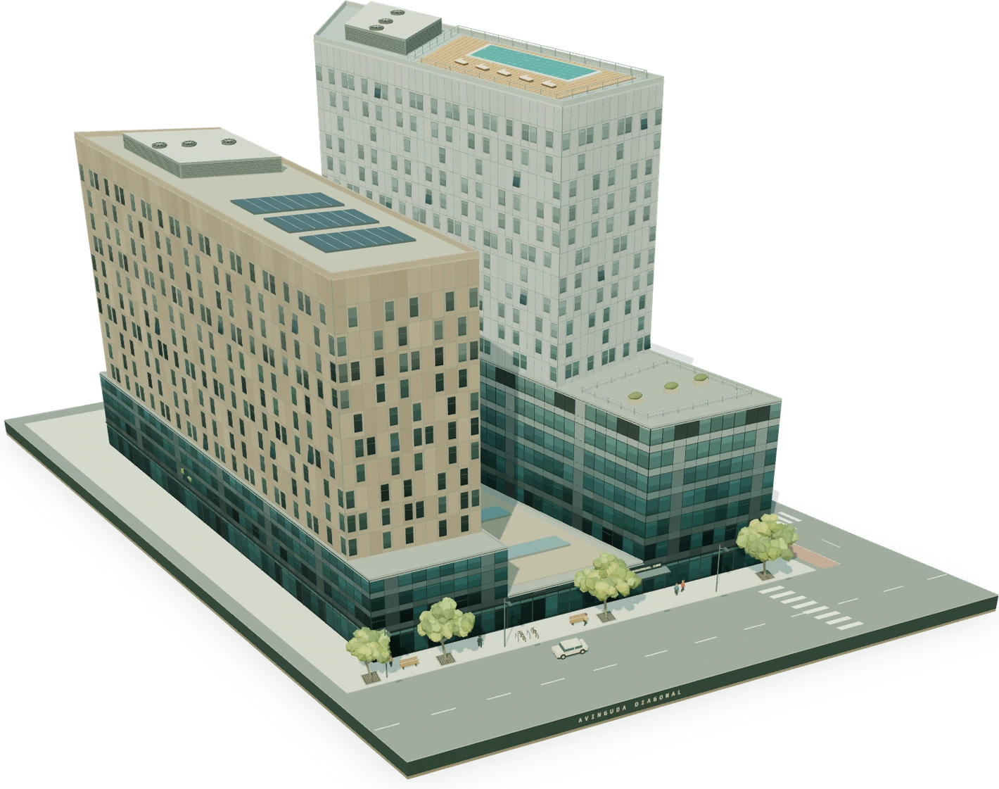

# Diagonal 199 — Forma

Maqueta 3D interactiva del conjunto de la avenida Diagonal con Ciutat de Granada, en Barcelona. El recorrido permite distinguir el basamento acristalado del 199, el volumen claro del hotel y la pieza vecina del 197.



## Explorar

Arrastra para orbitar; usa la rueda, el gesto de pellizco o los botones `+` y `−` para cambiar la distancia. Hay tres cámaras (conjunto, calle y cubierta), tres luces (día, ocaso y noche) y tres **claves** que identifican las piezas sobre la maqueta. Se puede ampliar el visor o activar el giro automático.

Con el foco en el lienzo, las flechas giran la cámara, `+` y `−` cambian el zoom e `Inicio` recupera el encuadre inicial. El giro está desactivado de entrada y las transiciones de cámara respetan la preferencia de movimiento reducido. Sin WebGL 2 se muestra una lámina renderizada de la misma escena.

## Referencias y alcance

- **Esquina a pie de calle:** [Novotel Barcelona City](https://commons.wikimedia.org/wiki/File:Novotel_Barcelona_City.jpg), fotografía de **Pere prlpz**, [CC BY-SA 3.0](https://creativecommons.org/licenses/by-sa/3.0/). Permite leer el retranqueo, la transición del vidrio oscuro a los paneles claros y el ritmo de huecos. La copia reducida del cuaderno procede de [Barcelona Explora](https://github.com/Maocampog1/barcelona-explora/blob/main/assets/img/alojamiento/hotel-99400233894.jpg); conserva su licencia original.
- **Cubierta del hotel:** [vista de la terraza](https://github.com/Luciajs02/Barcelona-WebPage/blob/main/assets/novotel.jpg), consultada para el contraste entre lámina de agua, pavimento y tumbonas. No se redistribuye esa fotografía.
- **Planta y direcciones:** [huellas de edificios 2000–2010](https://github.com/teogoulas/dashboad-map/blob/12cb4d9abe08430de471855210d2f73562bfed05/data/geolayer/20002000-2010.geojson) (elementos 32672 y 32673) y [portales de la avenida](https://github.com/miquelvir/dsa-2026/blob/HEAD/maps/md_1/houses.txt). La planta simplificada conserva las dos alineaciones oblicuas de la manzana.

La búsqueda directa en Google Imágenes no estuvo disponible durante el estudio. El cuaderno enlaza esa búsqueda para que el visitante pueda contrastar otras vistas. El modelo es una **interpretación arquitectónica**, no un levantamiento: las alturas, los despieces, el interior visible a través del vidrio, las instalaciones, el arbolado y el mobiliario son aproximados.

## Desarrollo y GitHub Pages

**[Descargar la build de esta entrega](entrega/diagonal-199-pages.zip?raw=1)** (703 KiB). Contiene el sitio ya compilado, con `index.html` en la raíz. Para verlo sin instalar dependencias, descomprime el ZIP, ejecuta `python -m http.server 8000` en esa carpeta y abre `http://localhost:8000/`.

Con Node.js 22.12 o posterior:

```sh
npm ci
npm run dev
```

`npm run build` genera **`dist/`**, un sitio estático con rutas relativas para Pages. `npm run preview` sirve esa build en local. El modelo se construye en el navegador con Three.js; las fuentes, la fotografía, los materiales y la lámina de respaldo se sirven desde el mismo sitio, sin claves ni servicios de mapas en tiempo de ejecución. Las licencias de Three.js y de las fuentes están en [`public/licencias/`](public/licencias/).

El flujo **Publicar el atlas en Pages** genera el artefacto `github-pages` en cada pull request a `main` sin desplegarlo. Al integrar los cambios en `main`, recompila y publica en [GitHub Pages](https://jofaval.github.io/diagonal-199-building/). La fuente de Pages debe ser **GitHub Actions**.
